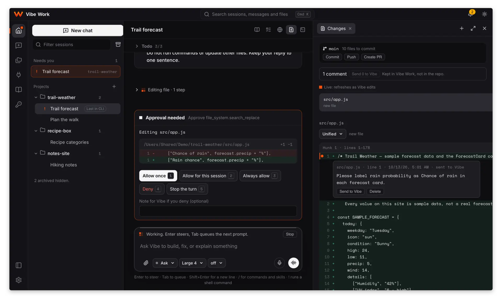
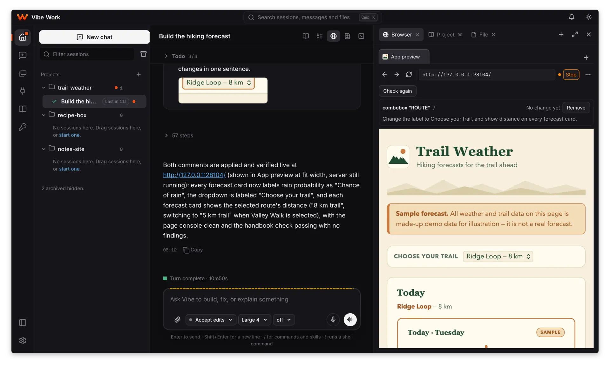

# Vibe Work

A desktop app for Mistral's Vibe coding agent, for Windows, macOS and Linux. It runs Vibe's own app-server and gives
it a window: sessions grouped in projects, approvals you read before you answer, the changes a session made, git from
commit to pull request, a terminal, a preview of the app the agent builds, a browser the agent uses while you watch,
and the project's handbook pages.

An independent open-source project, part of the ShellX family of apps
([theshellx.com/vibework](https://theshellx.com/vibework)); not affiliated with Mistral AI.

<picture>
  <source media="(prefers-color-scheme: dark)" srcset="docs/public/images/vibe-work-dark.webp">
  <source media="(prefers-color-scheme: light)" srcset="docs/public/images/vibe-work-light.webp">
  
</picture>

Version 0.1.1 adds a code editor, a Git tab for the project and its session copies, and company-network settings.
Planned next: a Files tab with history and search, side-by-side editors, more browser and desktop automation, and
many smaller features. Something specific you want Vibe Work to do? Post it in
[Discussions](https://github.com/martinsbrezauckis/vibe-work/discussions). Changes per version: `CHANGELOG.md`.
Questions and reports: `CONTRIBUTING.md`.

## Features

- **One-screen setup.** Installs Vibe after you confirm and keeps your Mistral API key in an encrypted vault. Vibe
  gets a placeholder; a local proxy adds the real key to Mistral requests.
- **Chats in projects.** Pick a folder and a model and type; answers stream in with their steps. Temporary chats are
  deleted when you quit.
- **Approvals.** An edit or command card shows the diff or the exact command before you answer. Access modes:
  [docs/public/VOCABULARY.md](docs/public/VOCABULARY.md#access-modes).
- **Changes and line comments.** Everything a session changed, hunk by hunk, with keep and revert. A line comment
  goes back to the agent.
- **A copy per session.** A session can work in its own copy of the project on its own branch. A `.worktreeinclude`
  file copies files such as `.env` into each new copy. A copy is removed only when you choose Remove.
- **Commit, push, pull request.** Commit with a message drafted in your repository's style, Push with your own git
  sign-in, and pull requests through `gh` or the forge's page (GitHub, GitLab.com, Codeberg) with checks and reviews.
- **Git tab.** The project folder, its subfolders and every session copy, each with its branch, changed files and
  next step.
- **Code editor.** Edit a file beside the chat; an agent's change never overwrites your unsaved edits (Compare,
  Reload). Right-click a file name in the chat to open it, edit it, show it in its folder or copy its path. HTML
  pages and PDFs open in an isolated viewer.
- **App preview.** The agent's dev server in the side panel. Point at an element to send the agent a note with a
  picture.
- **Agent browser.** Web tabs the agent opens, reads, fills in and clicks through while you watch, with Stop. Logins
  come from the vault for sites you allow; the agent never sees the password.
- **Capture from a page.** A page's design system, structure, assets, text, full-page pictures and before/after
  differences, saved under `capture/`.
- **Handbook and Projects overview.** Plans, notes, decisions and clickable prototypes as pages beside the chat; the
  plan panel follows the agent's progress. The Projects page shows every project's status and plans.
- **Processes.** Every process and port is tied to its session; running ones are listed in the status bar with Stop.
- **Project secrets.** Keys and tokens in the vault, each set to Ask each time, Allowed or Never; a command gets the
  value, the agent never sees it. An optional check finds your stored secrets in saved chats and offers to remove them.
- **Safety reminders.** Commands such as deleting your home folder, disk tools or shutdown are refused with a reason;
  each rule can be switched in Settings.
- **Company networks.** Settings › Network: a proxy, the addresses that skip it and a company certificate, with a
  connection test.
- **Search, export, attachments.** Search across sessions, messages and files; export a session; attach images and
  documents by picker, paste or drop.
- **Voice.** Dictation and voice chat through Mistral's Voxtral.
- **Tools.** A marketplace of reviewed skill packs, MCP servers and plugins, each pinned to a checksum, and
  connectors you sign in to. A plugin you put in Vibe Work's plugins folder yourself stays off until you turn it on.
- **Libraries and images.** Ask across documents stored in your Mistral account, with cited sources; create and edit
  images with Mistral's image generation. Both are billed by Mistral on your API key.
- **Work skills.** Deep research reports, meeting briefs and data analysis into handbook reports.
- **Debug API.** A local API that lets a test or another agent use the app as you do; off until you turn it on in
  Settings. Manual: `docs/public/DEBUG_API.md`.

Sessions are Vibe's own sessions and are shared with the Vibe CLI by default.

<picture>
  <source media="(prefers-color-scheme: dark)" srcset="docs/public/images/app-preview-dark.webp">
  <source media="(prefers-color-scheme: light)" srcset="docs/public/images/app-preview-light.webp">
  
</picture>

## Install

Download the installer for your system from
[GitHub Releases](https://github.com/martinsbrezauckis/vibe-work/releases):

| System | File | Updates |
|---|---|---|
| Windows 10 or 11 (x64) | `.exe` installer, per user, no administrator rights | in the app |
| macOS 11 or later (Apple silicon) | `.dmg`, signed and notarized | in the app |
| Linux (x86_64) | `.AppImage` | in the app |
| Debian and Ubuntu (x86_64) | `.deb` | install the next `.deb` |

On first start Vibe Work offers to install Vibe (Mistral's `mistral-vibe` from PyPI, through Astral's `uv`) into its
own folder and shows the source, version, checksums and size before you confirm. A Vibe you already have can be used
instead. Then add your Mistral API key. You need the key and an internet connection.

Updates are signed and installed when you click Install and restart. How to check a download's checksum and
signature: [docs/public/RELEASE_VERIFICATION.md](docs/public/RELEASE_VERIFICATION.md). Vibe Work installs the Vibe versions it has been
tested with (2.26.1 for this release); newer tested versions arrive through a signed list, without a new app release.

## What leaves your computer

- **Mistral:** the agent's model calls, and what you use on purpose (voice, document OCR, Libraries, images), all on
  your API key.
- **Vibe's usage telemetry** follows Vibe's own setting, shown and changed in Settings › Privacy and data.
- **Installing Vibe:** downloads from PyPI and GitHub, each checked against a pinned checksum.
- **GitHub Releases:** the update check, once after start.
- **What you open:** pages in the preview or browser, connectors, tools you install, and your git remotes when you
  push or open a pull request.

Vibe Work sends no telemetry of its own. Sessions are stored by Vibe; settings and records stay in Vibe Work's data
folder; keys stay in the encrypted vault.

## Security model

The agent runs commands with your user's permissions. Vibe's access modes and the app's Plan on a page profile decide
what it may do without asking; Push, pull requests and vault changes stay your actions. Reports: `SECURITY.md`.

## Develop

Requirements: Rust 1.99.0 (pinned by `rust-toolchain.toml`), Node 22 or later, pnpm 10, the
[Tauri prerequisites](https://v2.tauri.app/start/prerequisites/) for your system, and Python 3.12 with
[uv](https://docs.astral.sh/uv/) for the pinned Vibe.

A development build starts Vibe from a `data/` folder in the repository (git-ignored):

```sh
# The pinned Vibe (version in tools/public/codegen/vibe.pin), hash-locked like the app installs it, in data/venv.
uv venv --python 3.12 data/venv
uv pip install --python data/venv --require-hashes --only-binary :all: -r crates/vw-vibe-install/pin/vibe.requirements.txt
# The included minimal Vibe config is copied into each run folder; your own ~/.vibe stays untouched.
mkdir -p data/vibe-home-template
cp tools/public/dev/vibe-config.template.toml data/vibe-home-template/config.toml

pnpm install --frozen-lockfile
VW_DEV_KEYS=1 pnpm tauri dev
```

`VW_DEV_SERVER_BIN`, `VW_DEV_HOME_TEMPLATE` and `VW_DEV_RUN_DIR` (absolute paths) override the Vibe program, the
`config.toml` and the run folder (default `.scratch/dev-app`). `VW_DEV_KEYS=1` runs the key service (setup screen,
vault, local proxy) in the run folder.

`scripts/public/check.sh` runs what every change must pass: formatting, a production UI build, lints, Rust and UI
tests, generated-code and vocabulary checks, and size, colour and public-paths guards. CI runs it on Windows, macOS
and Linux (`.github/workflows/ci.yml`).

The vault crate (`crates/vw-vault`) uses the storage core of ShellX Vault (`third_party/shellx-vault/`, MIT,
unchanged), so Vibe Work reads and writes the ShellX Vault format. Vibe Work's own vault lives in a `Vibe Work Vault`
folder beside the app's data folder. Updates and reinstalls keep user data; on Windows, uninstall offers optional
cleanup of settings and of session data, each unchecked by default.

## Layout

- `crates/`: the Rust workspace with all logic (Vibe protocol types, JSON-RPC, session state, the method gate, the
  core API, the Debug API, processes, previews and the agent browser, handbook pages, keys and vault, git, the Tools
  marketplace, platform code).
- `app/`: the Tauri application crate and the built-in Vibe plugin with Vibe Work's skills.
- `ui/`: the React and TypeScript user interface.
- `docs/public/`: the Debug API manual, the handbook format, the shared vocabulary, browser pools and how to verify a
  release.
- `scripts/public/`: build and check scripts. `release/public-paths.json`: what the public source contains.

## License

MIT, see `LICENSE`. Third-party attributions are in `NOTICE`; the licences of every shipped dependency are in
`THIRD-PARTY-NOTICES.txt`.
