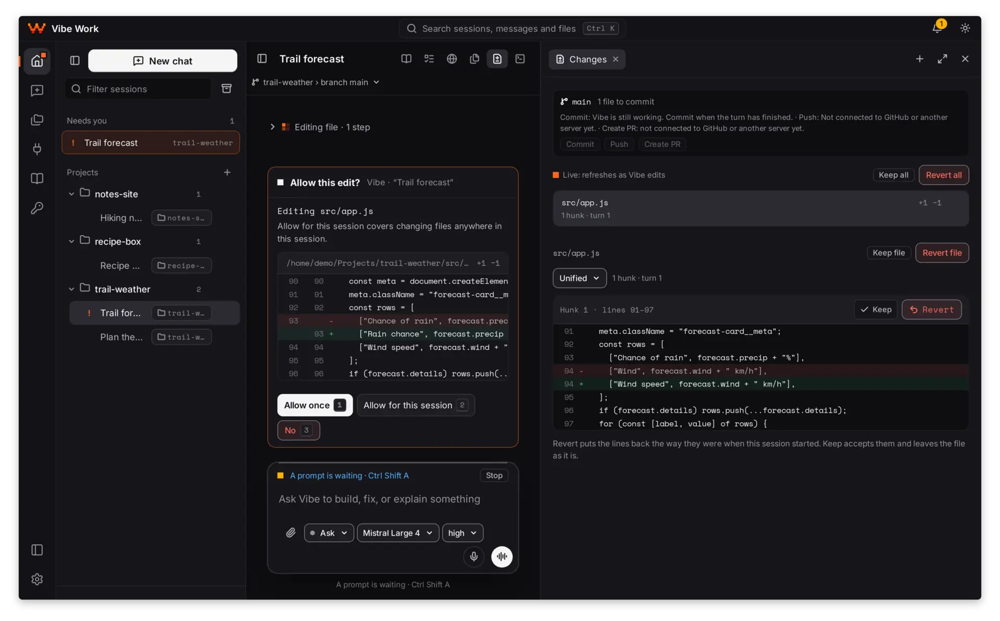
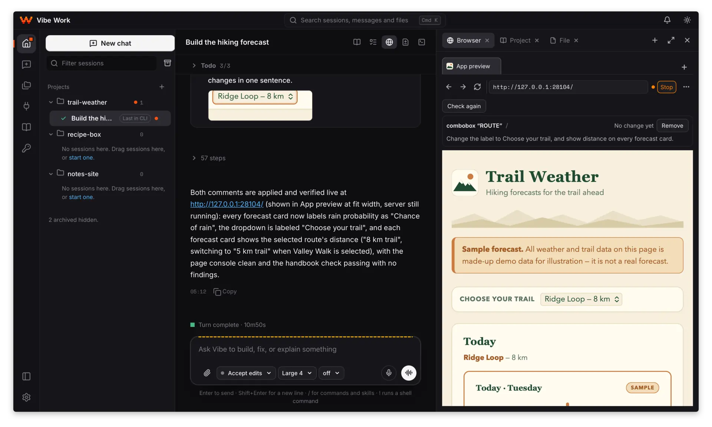

# Vibe Work

A desktop app for Mistral's Vibe coding agent, for Windows, macOS and Linux. It runs Vibe's own app-server and gives
it a window: sessions grouped in projects, approvals you read before you answer, the changes a session made, git from
commit to pull request, a terminal, a preview of the app the agent builds, a browser the agent uses while you watch,
and the project's handbook pages.

An independent open-source project, part of the ShellX family of apps
([theshellx.com/vibework](https://theshellx.com/vibework)); not affiliated with Mistral AI.

<picture>
  <source media="(prefers-color-scheme: dark)" srcset="docs/public/images/vibe-work-016-dark.webp">
  <source media="(prefers-color-scheme: light)" srcset="docs/public/images/vibe-work-016-light.webp">
  
</picture>

Version 0.1.11 adds browser profiles named as in Chrome and Edge, one-time codes on web pages, protected fields in more
languages and custom connectors with sign-in on Windows.
Something specific you want Vibe Work to do? Post it in
[Discussions](https://github.com/martinsbrezauckis/vibe-work/discussions). Changes per version: `CHANGELOG.md`.
Questions and reports: `CONTRIBUTING.md`.

## Features

- **One-screen setup.** Installs Vibe after you confirm and keeps your Mistral API key in an encrypted vault. Vibe
  gets a placeholder; a local proxy adds the real key to Mistral requests.
- **Chats in projects.** Pick a folder and a model and type; answers stream in with their steps. Type @ to mention a
  file or another session in the same folder; Up and Down in an empty message box recall earlier prompts, shared
  with the Vibe CLI. The agent searches text and file names in the chat's folders, respecting ignored files.
  Settings > Models and agent > Compaction point sets when each model's chats are compacted. Temporary chats need no
  folder: without one they work in an empty folder of their own. They are deleted when you quit.
- **Video review.** The agent can look at a local video on Windows, macOS and Linux through selected frames, scene
  changes and contact sheets shown in the chat, using the video support your computer already has.
- **Needs you.** A badge on the app icon or a mark in the tray shows when a chat is waiting for you.
- **Tray.** Closing the window keeps chats working in the tray (menu bar on macOS); notifications reopen the chat
  that needs you, and Quit ends the app. Settings > General > Keep running in the tray when the window closes turns
  this off (on macOS: Keep running in the menu bar when the window closes).
- **Approvals.** An edit card shows the change with the file's line numbers, a command card the exact command,
  before you answer. Access modes:
  [docs/public/VOCABULARY.md](docs/public/VOCABULARY.md#access-modes). A card says what Allow once or Allow for this
  session covers. Saying No on a card for Vibe's own tools (commands, file edits) stops the turn. A No in Vibe Work's
  own prompts (Git guard, processes, vault, documents, protected folders, cards for Vibe Work's tools) answers only
  that call and the turn goes on; the agent receives: `Not run: the user declined this. Nothing was done, so report it as not done, never as done. Explain why it is needed for the user's delegated task.` A tool guard prefixes this reason with its name.
  Unanswered cards wait until you answer; Stop or closing the chat counts as No. A new card waits until you stop
  typing, and a held key does not answer it.
  Review and revoke permissions in Settings > Allowed without asking.
- **Changes and line comments.** Everything a session changed, hunk by hunk, with keep and revert. A line comment
  goes back to the agent.
- **A copy per session.** A session can work in its own copy of the project on its own branch. A `.worktreeinclude`
  file copies files such as `.env` into each new copy. A copy is removed only when you choose Remove.
- **Commit, push, pull request.** Commit with a message drafted in your repository's style, Push with your own git
  sign-in, and pull requests through `gh` or the forge's page (GitHub, GitLab.com, Codeberg) with checks and reviews.
  Your Git name and email stay yours: when the agent starts a repository or commits and Git has none, Vibe Work asks
  you once and saves them in Git's settings.
- **Files and history.** Browse folders, search names and text, and open a result at its line. History shows saved
  versions, who changed what and what has not been published. Its repository view includes the project, subfolders
  and session copies, with Commit, Publish branch and Bring into main.
- **Code editor.** Open files in separate tabs, open a second editor to the side, or compare with a saved version.
  Vibe can read your open file and selection. Changes on different lines merge; changes on the same lines ask you
  which to keep. Open files save before Vibe works by default (Settings > General). HTML and Markdown open as a
  preview with Edit and Preview to the side; pictures and PDFs open as previews. Settings > Appearance controls
  file tabs and how HTML and Markdown open.
- **App preview.** The agent's dev server in the side panel. Point at an element to send the agent a note with a
  picture.
- **Agent browser.** Web tabs the agent opens, reads, fills in and clicks through while you watch, with Stop. Logins
  come from the vault for sites you allow; the agent never sees the password. It also works inside embedded frames
  such as sign-in boxes. It clicks canvas and image controls, and controls that only accept a real mouse click, only
  while the page still shows what it checked. In Ask mode reading and browsing run without a card; entering or sending
  information asks first, in every browser. On Windows, macOS and Linux, Settings > Browser blocks ads and trackers
  (Off, Balanced, Strict).
- **Your Chrome, Your Edge, Your Safari and Your Firefox.** Connect the extension in Settings > Browser > Your Chrome
  or Your Edge (Connect Chrome or Connect Edge), or on macOS in Settings > Browser > Your Safari. The agent works in
  your own Chrome, Microsoft Edge or Safari: each chat in its own window, as far as the chat's access mode allows,
  with Stop in the extension and on the page. In Firefox the agent works in a window Vibe Work opens with its own
  empty profile each time: Settings > Browser > Your Firefox > Open window (on Linux, Mozilla's Firefox from the .deb
  package or the download, not the Snap package). Local pages open like in a normal browser.
  Manual:
  [docs/public/BROWSER_CONTROL.md](docs/public/BROWSER_CONTROL.md).
- **Capture from a page.** A page's design system, structure, assets, text, full-page pictures and before/after
  differences, saved under `capture/`. The Browser tab's Capture menu also saves a PDF or one HTML file with pictures
  and styles for sharing.
- **Handbook and Projects overview.** Plans, notes, decisions and clickable prototypes as pages beside the chat; the
  plan panel follows the agent's progress. The Projects page shows every project's status and plans.
- **Processes.** Every process and port is tied to its session; running ones are listed in the status bar with Stop.
  Servers you start in a chat's Terminal tab are listed too, with their ports.
- **Project secrets.** Keys and tokens in the vault, each set to Ask, Always or User only; a command gets the
  value, the agent never sees it. An optional check finds your stored secrets in saved chats and names those chats.
- **Safety reminders.** Commands such as deleting your home folder, disk tools or shutdown are refused with a reason;
  each rule can be switched in Settings.
- **Company networks.** Settings > Network: HTTP, HTTPS or SOCKS proxies, addresses that skip them and a company certificate, with a
  connection test.
- **Search, export, attachments.** Search across sessions, messages and files; export a session; attach images and
  documents by picker, paste or drop. Long pastes fold into an openable chip. Turn on Send to Vibe Work in
  Settings > General to add files and folders from your file manager's right-click menu.
- **Right-click actions.** Point Vibe at a file, a line, selected terminal output, a web page or a handbook section.
  The menu also offers the relevant open, history, compare, copy and revert actions.
- **Voice.** Dictation and voice chat through Mistral's Voxtral. Ask Vibe to read its last reply aloud once, with
  Skip and Stop, without turning on automatic narration. When the computer has no audio output, the reading bar says
  so. A short sound when Vibe asks, and Vibe Work can read the question aloud; in your own voice chat you can answer a
  local file prompt with "allow" and the number Vibe Work reads, or "no".
- **Accessibility.** Settings > Accessibility: text size from 100 to 200%, the system theme, contrast and motion.
  Windows contrast themes are followed, and screen readers find the chat's regions, speakers and messages.
- **Usage.** Settings > Usage and plan shows a chat's cost, steps, cached tokens and tool calls, also for
  each subagent, and your monthly plan usage when Mistral reports it. Context in the status bar opens a breakdown
  of the last model call.
- **Send feedback.** Report a bug or a suggestion from Settings > About, the tray menu or `/feedback`, with an
  optional screenshot that leaves out your secrets.
- **Tools.** A marketplace of reviewed skill packs, MCP servers and plugins, each pinned to a checksum, and
  connectors you sign in to or, when they need no sign-in, connect with one click. Tools > Skills browses,
  installs, turns on, turns off and removes skills, and shows when each skill you added last changed. When a task
  needs a connector you have not set up, the agent can point you to it; you connect it yourself.
  Install offers show the source, licence and what runs before you confirm. A plugin you put in Vibe Work's plugins
  folder yourself stays off until you turn it on.
  For the Headless browser’s Chromium download, allow it in your antivirus or retry after its scan finishes.
- **Libraries and images.** Ask across documents stored in your Mistral account, with cited sources; create and edit
  images with Mistral's image generation. Both are billed by Mistral on your API key.
- **Work skills.** Deep research reports, meeting briefs and data analysis into handbook reports.
- **Debug API.** A local API that lets a test or another agent use the app as you do; off until you turn it on in
  Settings > Developer. Tools need its token, kept in your vault. Manual: `docs/public/DEBUG_API.md`.

Sessions are Vibe's own sessions and are shared with the Vibe CLI by default.

<picture>
  <source media="(prefers-color-scheme: dark)" srcset="docs/public/images/app-preview-dark.webp">
  <source media="(prefers-color-scheme: light)" srcset="docs/public/images/app-preview-light.webp">
  
</picture>

## Install

Download the installer for your system from
[GitHub Releases](https://github.com/martinsbrezauckis/vibe-work/releases):

| System | File | Updates |
|---|---|---|
| Windows 10 1809 (build 10.0.17763) or later (x64) | `.exe` installer, per user, no administrator rights | in the app |
| macOS 14 or later (Apple silicon) | `.dmg`, signed and notarized | in the app |
| Linux (x86_64): Ubuntu 24.04 and 26.04, Debian 13 | `.AppImage` | in the app |
| Ubuntu 24.04 and 26.04, Debian 13 (x86_64) | `.deb` | install the next `.deb` |

On first start Vibe Work offers to install Vibe (Mistral's `mistral-vibe` from PyPI, through Astral's `uv`) into its
own folder and shows the source, version, checksums and size before you confirm. A Vibe you already have can be used
instead. Then add your Mistral API key. You need the key and an internet connection.

Both Linux packages bring their own web engine (WebKitGTK), so the system's engine version does not matter. Debian 12
is not supported: its system library (glibc) is older than the packages need. The glibc version required is measured
from each release AppImage and its bundled programs; it is not one fixed minimum for every build. Before downloading
an update, Settings > Updates checks the announced macOS version, Windows build or glibc version and says if yours
is too old.

Updates are signed and installed when you click Install and restart. How to check a download's checksum and
signature: [docs/public/RELEASE_VERIFICATION.md](docs/public/RELEASE_VERIFICATION.md). Vibe Work installs the Vibe versions it has been
tested with (3.1.2 for this release); newer tested versions arrive through a signed list, without a new app release.

## Send files or text to a chat

Turn on Settings > General > Send to Vibe Work > Right-click menus. Then right-click a file or folder:

- Windows: Send to Vibe Work (under Show more options on Windows 11), or Send to > Vibe Work.
- macOS: Send to Vibe Work in Finder's Services menu. Selected text in another app also has Services > Ask Vibe Work.
- Linux: Scripts > Send to Vibe Work in Files, Send to Vibe Work in Dolphin, or Open with.

Items appear in the open chat's message box, or in New chat if none is open. Documents are read automatically,
just like files added with Attach. Folders are references to where they are on this computer. Nothing is sent to
the chat until you press Send. Selected text from other apps is a macOS
Services feature; the file and folder entries are available on all three systems.

## Vault and permissions

Choose in setup or vault settings: unlock with your system sign-in (the key is kept in this computer's
credential store), or enter the vault password each time (no unlock key is saved). With system sign-in, an unlocked
vault opens unlocked at the next start and after an update; Lock keeps it locked. Settings > Account > Lock the
vault when Vibe Work quits turns on locking at every quit. After updating from 0.1.1 or 0.1.0 with Remember on this
computer on, enter the password once.

Permission cards show the action and wait until you answer. Saying No on a card for Vibe's own tools stops the
turn; write what to do instead in the chat. A No in Vibe Work's own prompts answers only that call and the turn
goes on; the agent receives: `Not run: the user declined this. Nothing was done, so report it as not done, never as done. Explain why it is needed for the user's delegated task.` A tool guard prefixes this reason with its name. Ctrl/Cmd+Shift+A goes to a waiting prompt. The session header lists its permissions; Settings > Allowed without asking lists permissions
you can revoke and links to the controls for lasting choices.

## What leaves your computer

- **Mistral:** the agent's model calls, and what you use on purpose (voice, document OCR, Libraries, images), all on
  your API key.
- **Vibe's usage telemetry** follows Vibe's own setting, shown and changed in Settings > Privacy and data.
- **Installing Vibe:** downloads from PyPI and GitHub, each checked against a pinned checksum.
- **GitHub Releases:** the update check and the signed list of supported Vibe versions, shortly after start and
  then once a day while Vibe Work runs.
- **What you open:** pages in the preview, the Browser, Your Chrome, Your Edge or Your Safari, connectors, tools you
  install, and your git remotes when you push or open a pull request.
- **Send feedback:** only when you press Send: the report you reviewed, and the screenshot and app and system
  info if you added them.

Vibe Work sends no telemetry of its own. Sessions are stored by Vibe; settings and records stay in Vibe Work's data
folder; keys stay in the encrypted vault.

## Security model

The agent runs commands with your user's permissions. Vibe's access modes and the app's Plan on a page profile decide
what it may do without asking; Push, pull requests and vault changes stay your actions. Changes to Vibe's settings,
skills and agent profiles can be proposed as file changes for your approval. The bell groups refusals and permission
decisions with links to the chat. Reports: `SECURITY.md`.

Settings > General > Let Vibe read GitHub with your gh login lets the agent read pull requests, issues and checks
using a sign-in you already set up with the GitHub command-line app. This connection refuses writes and keeps the
token outside the agent.

## Develop

Requirements: Rust 1.99.0 (pinned by `rust-toolchain.toml`), Node 22 or later, pnpm 10, the
[Tauri prerequisites](https://v2.tauri.app/start/prerequisites/) for your system, and Python 3.14.8 with
[uv](https://docs.astral.sh/uv/) for the pinned Vibe.

A development build starts Vibe from a `data/` folder in the repository (git-ignored):

```sh
# The pinned Vibe (version in tools/public/codegen/vibe.pin), hash-locked like the app installs it, in data/vibe-3.1.2/venv.
uv venv --python 3.14.8 data/vibe-3.1.2/venv
uv pip install --python data/vibe-3.1.2/venv --require-hashes --only-binary :all: --no-deps -r crates/vw-vibe-install/pin/vibe.requirements.txt
# The included minimal Vibe config is copied into each run folder; your own ~/.vibe stays untouched.
mkdir -p data/vibe-home-template
cp tools/public/dev/vibe-config.template.toml data/vibe-home-template/config.toml

pnpm install --frozen-lockfile
VW_DEV_SERVER_BIN="$PWD/data/vibe-3.1.2/venv/bin/vibe-app-server" VW_DEV_KEYS=1 pnpm tauri dev
```

`VW_DEV_SERVER_BIN`, `VW_DEV_HOME_TEMPLATE` and `VW_DEV_RUN_DIR` (absolute paths) override the Vibe program, the
`config.toml` and the run folder (default `.scratch/dev-app`). `VW_DEV_KEYS=1` runs the key service (setup screen,
vault, local proxy) in the run folder.
`VW_APP_DATA_DIR` sets a development build's own app data and browser storage folder. With `VW_DEV_KEYS_STORE=os`,
the development vault uses the real OS credential store for its saved unlock key; otherwise that key stays in memory.

For browser development with `VW_DEBUG_DESCRIPTOR`, open the private `Browser dev UI` link printed by Vite.
It authorizes that browser for this run; reopen the new link after restarting Vite. Keep the link private.
The browser receives a session cookie; the Debug API bearer stays in the dev server.

When updating an older development environment, create a fresh Python 3.14.8 venv and install the
hash-locked requirements above; upgrading packages inside a Python 3.12 venv cannot upgrade Python.
For an isolated checkout whose `data` is shared, create the venv outside that shared folder and set
`VW_DEV_SERVER_BIN`, `VW_TEST_VIBE_SERVER` and `VIBE_PYTHON` to its absolute executable paths.

`scripts/public/check.sh` runs what every change must pass: formatting, a production UI build, lints, Rust and UI
tests, generated-code and vocabulary checks, and size, colour and public-paths guards. CI runs it on Windows, macOS
and Linux (`.github/workflows/ci.yml`).

The vault crate (`crates/vw-vault`) uses the storage core of ShellX Vault (`third_party/shellx-vault/`, MIT,
unchanged), so Vibe Work reads and writes the ShellX Vault format. Vibe Work's own vault lives in a `Vibe Work Vault`
folder beside the app's data folder. Updates and reinstalls keep user data; on Windows, uninstall offers optional
cleanup of settings and of session data, each unchecked by default.

## Layout

- `crates/`: the Rust workspace with all logic (Vibe protocol types, JSON-RPC, session state, the method gate, the
  core API, the Debug API, processes, previews and the agent browser, handbook pages, keys and vault, git, the Tools
  marketplace, platform code).
- `app/`: the Tauri application crate and the built-in Vibe plugin with Vibe Work's skills.
- `ui/`: the React and TypeScript user interface.
- `docs/public/`: the Debug API manual, the handbook format, the shared vocabulary, browser pools, Chrome Control and
  how to verify a release.
- `scripts/public/`: build and check scripts. `release/public-paths.json`: what the public source contains.

## License

MIT, see `LICENSE`. Third-party attributions are in `NOTICE`; the licences of every shipped dependency are in
`THIRD-PARTY-NOTICES.txt`.
